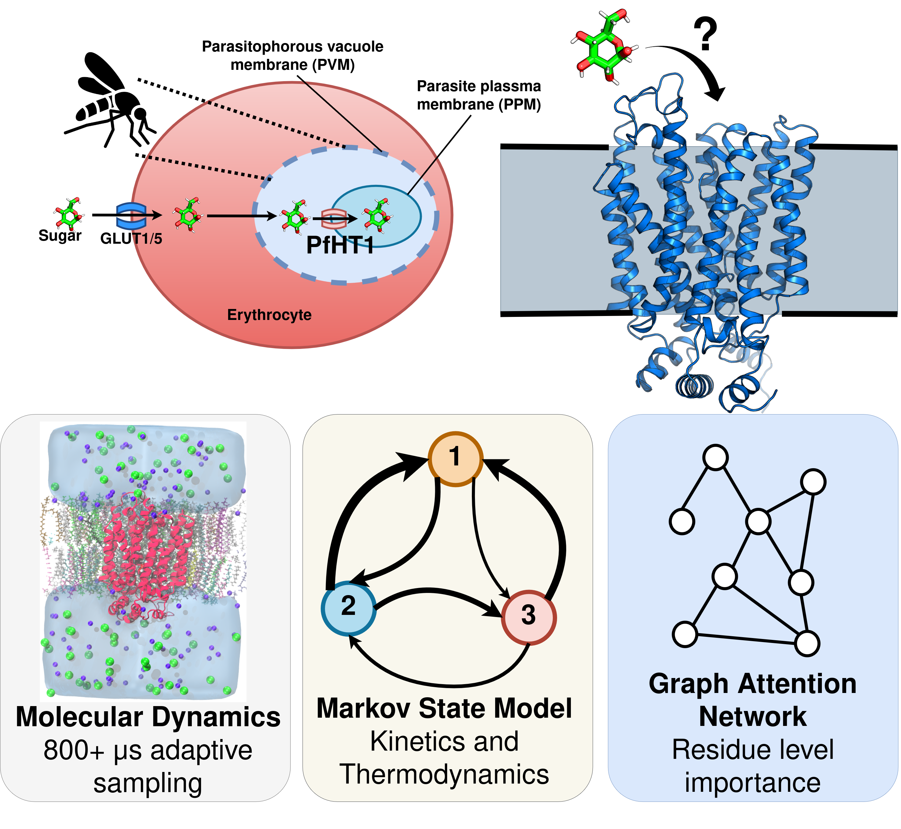

## PfHT1
Title of Manuscript.

---

## Overview

This repository accompanies our PfHT1 molecular mechanism study and contains:
- Graph Attention Network (GAT) model
- preprocessing script for graph generation
- pretrained model weights

Large datasets including molecular dynamics trajectories, topology files, MSM data, and processed simulation datasets are hosted separately in the associated data repository.

---

<p align="center">
  
</p>

---

## Repository Contents

```text
PfHT1-GAT/
├── preprocessing/make_input_graphs.py
├── GAT_Model/gat_model.ipynb
├── GAT_Model/best_model.pt
├── requirements.txt
└── figures/
```

---

## Workflow

Generate graph inputs:

```bash
python make_input_graphs.py \
    --trajectory traj.xtc \
    --topology system.prmtop
```

The notebook `gat_model.ipynb` contains:
- model architecture
- training workflow
- inference and evaluation

Pretrained weights:
```text
pfht1_gat_weights.pt
```

---

## Additional Data

The following files are hosted separately due to size limitations:
- MD trajectories
- topology (`.prmtop`) files
- MSM datasets
- processed graph datasets

Data repository:
[DATA REPOSITORY LINK]

---

## Citation

If you use this repository, please cite:

```text
[PAPER CITATION]
```

---
